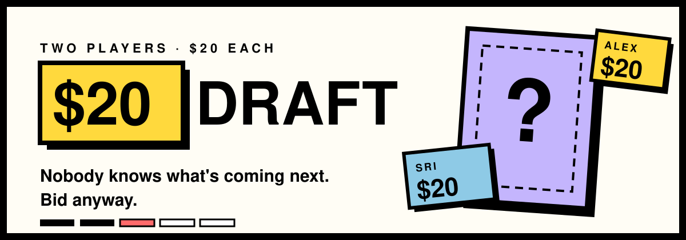
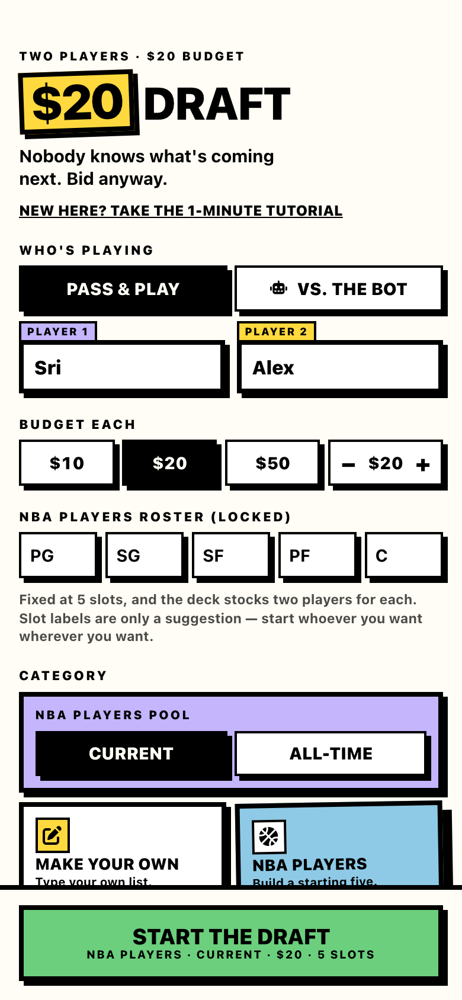
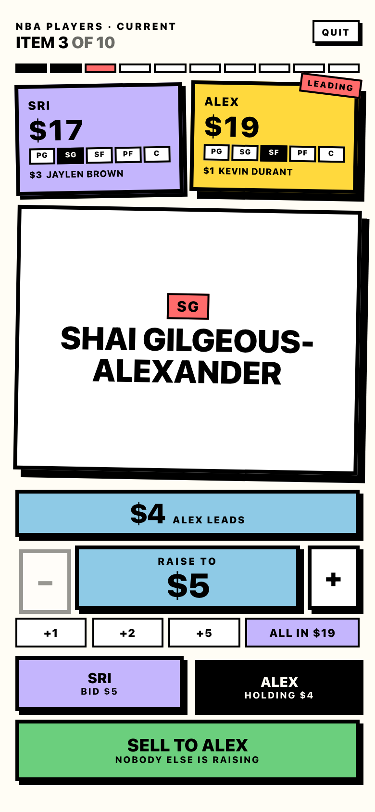
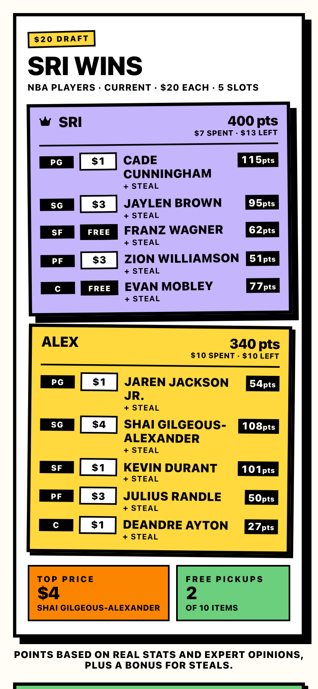

 

### The $20 draft from TikTok, as a real game.

Two players. $20 each. A deck nobody has seen. 
**Do you blow it all on the first card, or wait for something better?**

 

<table>
<tr>
<td width="33%" align="center"></td>
<td width="33%" align="center"></td>
<td width="33%" align="center"></td>
</tr>
<tr>
<td align="center"><b>1 · Pick a category</b> NBA, movies, snacks, or your own list</td>
<td align="center"><b>2 · Bid blind</b> raise, hold, or go all in</td>
<td align="center"><b>3 · Argue about it</b> scored rosters, ready to share</td>
</tr>
</table>

## 🃏 How it plays

> [!TIP]
> **The whole game in one line:** a card flips, you both bid, highest bid takes it, repeat until both rosters are full.

- 💸 **Bid blind.** Either player opens at $1. Raises go back and forth until someone stops.
- 🔥 **Go broke if you want.** Nothing stops you spending $19 on the first card you love. Once you're out, your opponent names their price on everything after.
- 🏆 **Build the better lineup.** Rosters are scored on real stats and expert opinion, with a bonus for steals. Then you screenshot it and argue.

## 🎮 Ways to play

<table>
<tr>
<td width="33%" valign="top">

### 📱 One phone
Pass it back and forth, or one person runs the game while two people shout bids across the room.

</td>
<td width="33%" valign="top">

### 🌐 Online
Two phones, two places. Share a room code or browse open rooms and jump in.

</td>
<td width="33%" valign="top">

### 🤖 Vs. the bot
Plays from what it can see: the card, both wallets, what's gone by. Never the deck.

</td>
</tr>
</table>

## 🗂️ Categories

| | |
| --- | --- |
| 🏀 **Sports** | NBA · NFL · MLB · NHL, current or all-time, plus soccer from Fox Sports' World Cup 2026 top 100. NBA and NFL draft a real starting lineup by position. |
| 📺 **Nostalgia** | Childhood cartoons · TV shows · childhood stuff · fictional duos |
| 🎬 **Screen & people** | Iconic movies · celebrities |
| 🍕 **Food** | Foods · drinks · desserts · pizza toppings · Trader Joe's |
| ☀️ **Just vibes** | Your perfect life · the perfect summer day |
| ✏️ **Make your own** | Type any list and draft it |

## ⚙️ Under the hood

Built solo and shipped to real players.

- 🧠 **One pure rules engine.** The whole rulebook is a single reducer. The UI only dispatches actions, so the same engine runs local games, the bot, and online rooms.
- 🔒 **Online play that can't be peeked.** Supabase Edge Functions own the game state, Realtime keeps both phones in sync, and row-level security means neither player can see the deck.
- 🧪 **Tested like it matters.** 100% line coverage on the engine, a fuzz suite that plays hundreds of full games, component tests in real Chromium, Playwright runs against the production build, axe accessibility checks, and k6 load tests on the backend.
- 🕵️ **Privacy-first analytics.** PostHog in cookieless mode: no consent banner, and player names and room codes never leave the device.
- 🎨 **Neo-brutalist design.** Hard shadows, thick borders, and every colour checked for WCAG AA contrast.

> Want to run it locally or contribute? See **[docs/DEVELOPMENT.md](docs/DEVELOPMENT.md)**.

## 💬 Feedback

Hated a card? Missing a category?
**[Send feedback](https://docs.google.com/forms/d/e/1FAIpQLScjDk1NuuvdJtVEwnNNnEWmG6MmhVPZ3vgq9xIG12fiyQrRoQ/viewform)** or **[open an issue](https://github.com/sevensrig/blind-draft/issues)**.

 

